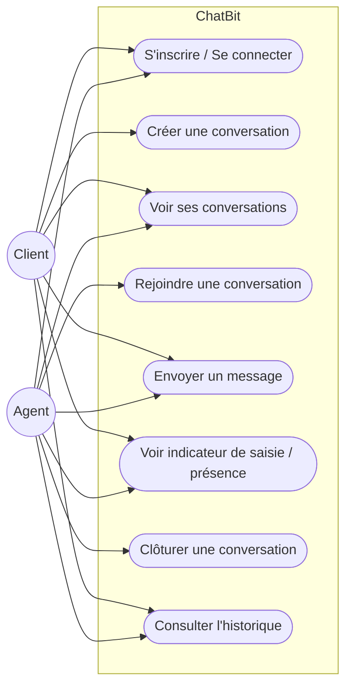
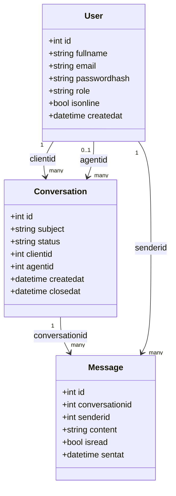
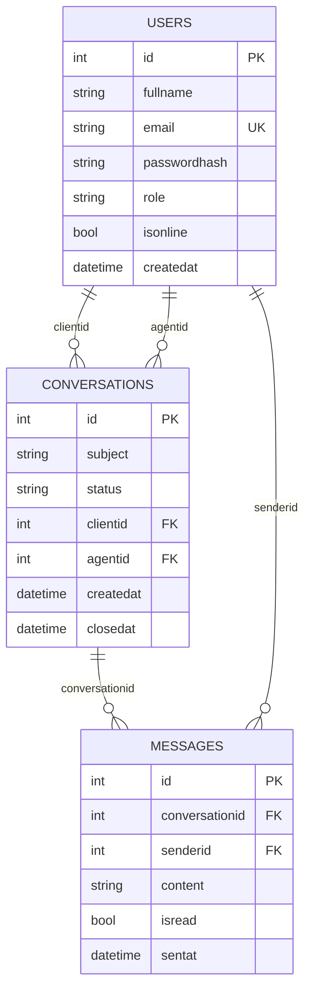
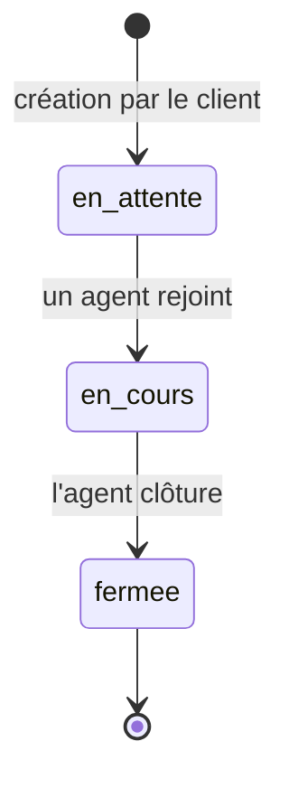
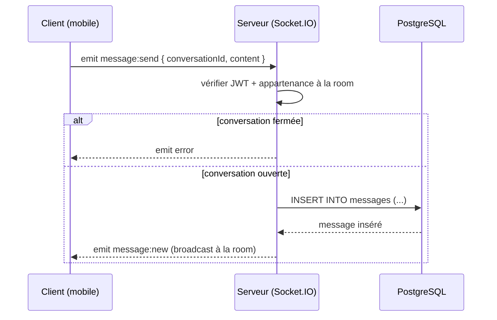
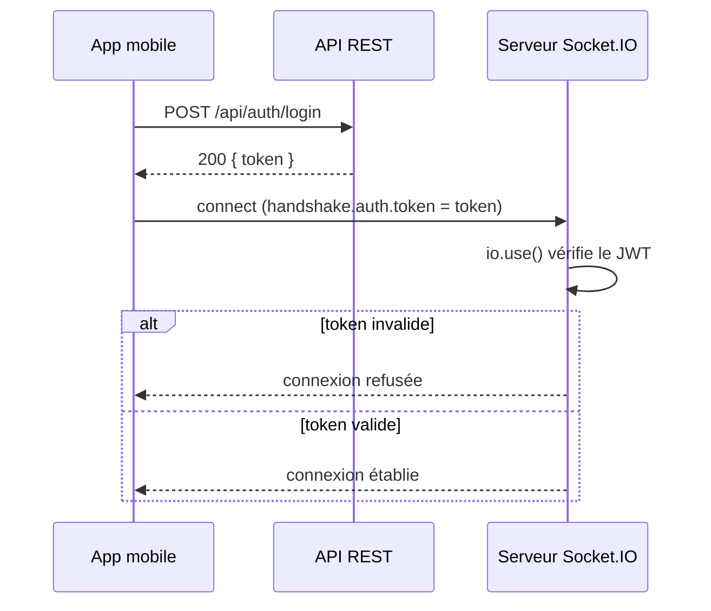

# ChatBit — Support client temps réel pour Souq Express

ChatBit est une application mobile de chat support client en temps réel, développée pour **Souq Express**, un e-commerce marocain fictif. Elle remplace le support par téléphone/e-mail par une messagerie instantanée façon WhatsApp entre **clients** et **agents**, avec historique centralisé, indicateur de saisie et présence en ligne.

Projet pédagogique centré sur **WebSocket** (via Socket.IO) : contrairement au HTTP requête/réponse, le serveur pousse ici des données au client sans que celui-ci les demande.

---

## Sommaire

- [Stack technique](#stack-technique)
- [Fonctionnalités](#fonctionnalités)
- [Architecture du dépôt](#architecture-du-dépôt)
- [Modélisation](#modélisation)
- [Prérequis](#prérequis)
- [Installation](#installation)
- [Variables d'environnement](#variables-denvironnement)
- [Lancer le projet](#lancer-le-projet)
- [Base de données](#base-de-données)
- [Documentation API](#documentation-api)
- [Événements WebSocket](#événements-websocket)
- [Endpoints REST](#endpoints-rest)
- [Démonstration](#démonstration)
- [Auteur](#auteur)

---

## Stack technique

| Côté | Technologies |
|---|---|
| Mobile | Expo Router, React Native, Axios, TanStack Query, socket.io-client |
| Backend | Node.js, Express, Socket.IO, JWT + bcrypt |
| Base de données | PostgreSQL |
| Documentation | OpenAPI 3.0 + Scalar UI |

---

## Fonctionnalités

- Inscription / connexion (mot de passe hashé avec bcrypt, session gérée par JWT)
- Deux rôles : **client** et **agent**
- Le client crée une conversation (statut initial `en_attente`)
- L'agent voit les conversations en attente / en cours et en rejoint une (statut → `en_cours`)
- Chat en temps réel avec persistance en base ; historique chargé via REST, nouveaux messages via WebSocket
- Indicateur de saisie (typing) et présence en ligne / hors ligne
- Clôture de conversation par l'agent → le client est notifié en temps réel et ne peut plus écrire
- *Bonus* : accusés de lecture, compteur de messages non lus, notification à la réception d'un message hors de l'écran de chat

---

## Architecture du dépôt

```
chatbit/
├── backend/
│   ├── src/
│   │   ├── config/           # connexion DB, variables d'environnement
│   │   ├── middlewares/      # auth JWT (REST), rôles, gestion d'erreurs
│   │   ├── sockets/          # middleware JWT socket, handlers (message, typing, presence, conversation)
│   │   ├── routes/           # auth, users, conversations
│   │   ├── controllers/
│   │   ├── repositories/     # requêtes SQL paramétrées
│   │   ├── docs/             # openapi.yaml
│   │   ├── app.js            # app Express + montage /docs
│   │   └── server.js         # serveur HTTP + Socket.IO
│   ├── schema.sql
│   ├── .env.example
│   └── package.json
├── mobile/
│   ├── app/                  # routes Expo Router
│   │   ├── (auth)/
│   │   └── (app)/conversations/
│   ├── src/
│   │   ├── api/               # instance Axios + appels REST
│   │   ├── context/           # AuthContext, SocketContext
│   │   ├── hooks/              # useAuth, useSocket, useConversations, useMessages
│   │   └── components/
│   └── package.json
└── README.md
```

---

## Modélisation

### Diagramme de cas d'utilisation



### Diagramme de classes



### Modèle de données (ERD)



### Diagramme d'états — statut d'une conversation



### Diagramme de séquence — envoi d'un message



### Diagramme de séquence — authentification + connexion socket



---

## Prérequis

- Node.js ≥ 18
- npm
- PostgreSQL installé localement
- Expo Go (app mobile) ou un simulateur iOS/Android

---

## Installation

```bash
git clone https://github.com/<votre-compte>/chatbit.git
cd chatbit

# Backend
cd backend
npm install

# Mobile
cd ../mobile
npm install
```

---

## Variables d'environnement

Copier `.env.example` en `.env` dans `backend/` et renseigner les valeurs :

```env
# backend/.env.example
PORT=3000

DB_HOST=localhost
DB_PORT=5432
DB_USER=chatbit_user
DB_PASSWORD=chatbit_password
DB_NAME=chatbit_db

JWT_SECRET=change_this_secret
JWT_EXPIRES_IN=1d
```

Côté mobile, l'URL de l'API/du serveur socket est définie dans `mobile/src/api/config.ts` (ou `.env` via `expo-constants`) :

```env
# mobile/.env.example
EXPO_PUBLIC_API_URL=http://localhost:3000
```

---

## Lancer le projet

### 1. Démarrer PostgreSQL

S'assurer que le service PostgreSQL local est démarré (`sudo service postgresql start` sur Linux, `brew services start postgresql` sur macOS, ou automatiquement au démarrage sur Windows), puis créer la base si ce n'est pas déjà fait :

```bash
psql -U postgres
CREATE USER chatbit_user WITH PASSWORD 'chatbit_password';
CREATE DATABASE chatbit_db OWNER chatbit_user;
\q
```

### 2. Appliquer le schéma

```bash
psql -h localhost -U chatbit_user -d chatbit_db -f backend/schema.sql
```

### 3. Démarrer le backend

```bash
cd backend
npm run dev
```

### 4. Démarrer l'app mobile

```bash
cd mobile
npx expo start
```

Scanner le QR code avec Expo Go, ou lancer un simulateur iOS/Android depuis le terminal Expo.

### 5. Démarrer avec Docker (Alternative Tout-en-un)

Vous pouvez lancer l'intégralité du projet (Base de données PostgreSQL + Backend API + Client Web) avec une seule commande Docker Compose :

```bash
docker compose up --build
```

- **Client Web** : [http://localhost:8080](http://localhost:8080)
- **Backend API** : [http://localhost:3000](http://localhost:3000)
- **Documentation API** : [http://localhost:3000/docs](http://localhost:3000/docs)

Voir [`DOCKER.md`](DOCKER.md) pour la documentation complète sur Docker.

---

## Base de données

Le script complet est dans [`backend/schema.sql`](backend/schema.sql). Trois tables :

- **users** — `id, fullname, email (unique), passwordhash, role, isonline, createdat`
- **conversations** — `id, subject, status, clientid, agentid (nullable), createdat, closedat`
- **messages** — `id, conversationid, senderid, content, isread, sentat`

---

## Documentation API

La documentation interactive de l'API REST (OpenAPI + Scalar UI) est disponible une fois le backend lancé :

```
http://localhost:3000/docs
```

---

## Événements WebSocket

### Client → Serveur

| Événement | Description |
|---|---|
| `conversation:join` | Rejoindre la room d'une conversation |
| `conversation:leave` | Quitter la room d'une conversation |
| `message:send` | Envoyer un message dans une conversation |
| `typing:start` | L'utilisateur commence à taper |
| `typing:stop` | L'utilisateur arrête de taper |

### Serveur → Client

| Événement | Description |
|---|---|
| `message:new` | Nouveau message diffusé à la room |
| `typing:update` | Mise à jour de l'indicateur de saisie |
| `presence:update` | Mise à jour du statut en ligne/hors ligne |
| `conversation:updated` | Changement de statut d'une conversation (ex : clôture) |
| `error` | Erreur (ex : message envoyé sur une conversation fermée) |

---

## Endpoints REST

| Méthode | Route | Accès |
|---|---|---|
| POST | `/api/auth/register` | Public |
| POST | `/api/auth/login` | Public |
| GET | `/api/users/me` | JWT |
| GET | `/api/conversations` | JWT |
| POST | `/api/conversations` | Client |
| GET | `/api/conversations/:id/messages` | JWT (paginé) |
| PATCH | `/api/conversations/:id/close` | Agent |

---

## Démonstration

La soutenance nécessite deux appareils/simulateurs connectés simultanément : un compte **client** et un compte **agent**, afin de démontrer le flux complet (création → prise en charge → échange en temps réel → clôture).

---

## Auteur

Ahmed ([@Sisouko](https://github.com/Sisouko))
